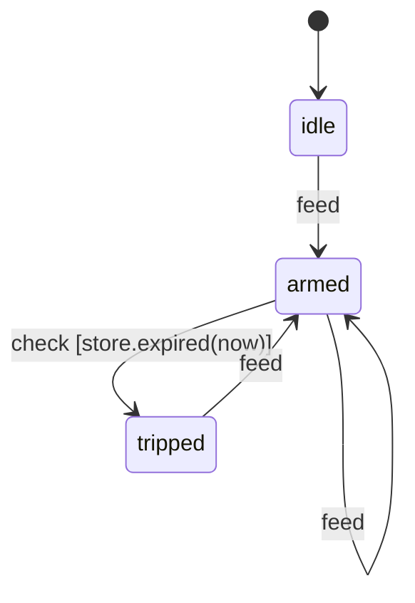

# watchdog — Service Spec

## Purpose
Reference timed service for msrs: raises an alarm when heartbeats (`Feed`)
stop for longer than a timeout, and clears it when they resume. It exists to
show the pattern for deadline-driven services — `CycleIngressTask` →
`FsmBatchTask` → `BatchEgressTask` — and to run the replay-determinism gate
over a decision that depends on time.

## Messages
| Direction | Type | Contents | Notes |
|-----------|------|----------|-------|
| Inbound   | `Feed` | heartbeat sequence number | delivered to the FSM inside `FeedCycle = Cycle<Feed>` |
| Outbound  | `Alarm` | `Armed`, `Tripped { silent_ns }`, `Recovered` | forwarded as `AlarmBatch = Batch<Alarm>` |

## Transport
In-process `Pulse` transport (feeds on a schedule, collects alarms). Default
`RtConfig`.

## State Machine

Each cycle dispatches one `feed` per drained event, then one `check`.
`idle` and `tripped` handle `check` without a transition.

## Store
`WatchdogStore { timeout_ns, last_feed_ns }`. `record_feed(now)` stores the
cycle time of the latest feed; `expired(now)` is true once armed and
`now - last_feed_ns > timeout_ns`; `silent_ns(now)` reports the gap.

## Timing
There is no `Tick`: `CycleIngressTask` emits a `Cycle` every iteration, so
`Cycle::now_ns` (sampled after the drain, recorded in the log) is the only
time source. A feed drained in a cycle is stamped with that cycle's `now_ns`.

## Acceptance Criteria
- [x] Unit tests: one per diagram edge, plus the guard-rejection path
- [x] End-to-end run over the in-process transport with the real clock
- [x] Replay determinism gate passes (bit-identical diff)
